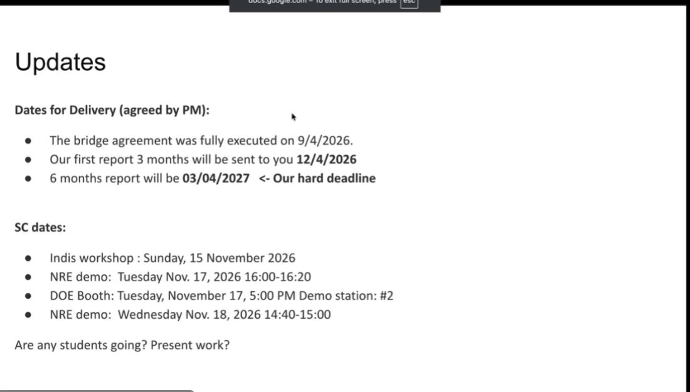

# 2026-10-27 SciNet 会议：Network Agent 反馈、Telemetry 方案与集成安排

> **日期**：2026-10-27，用户称为“今天的 SCINET 会议”。
>
> **材料与可靠性**：用户提供的英文自动转录、Updates slide 截图和四个链接。转录没有 speaker labels 或时间戳，人名、术语和部分数字有误识别。下文按问答关系整理；能够辨认的发言者包括 Mariam、KK、Harvey、John、Linxuan 和负责 telemetry 展示的 SB，但这不是完整参会名单。不确定归属使用“参会者”，不强行指定姓名。
>
> **记录重点**：按用户要求，Network Agent 部分只保留定位所需的简短背景，重点记录其他人的评论、追问和建议；Telemetry Agent 部分记录介绍内容及讨论，**不归为 Linxuan 的工作或待办**。附录 B 折叠保留完整原始转录，供回查。
>
> **相关背景**：[10 月 22 日 Network Agent v1 讨论](20261022_withkksb_networkagentv1.md)、[10 月 23 日 Telemetry Agent 职责讨论](20261023_withkksb_telemetryagent.md)。本记录不替代或改写当时意见。

## 核心摘要

1. **交付节点更新**：Updates slide 列出首份三个月报告为 **2026-12-04**，六个月报告硬截止为 **2027-03-04**。Phase 2 proposal 的提交日仍未确认；不能将三月交付日直接当作 proposal 截止日。部分团队对合同实际完成时间提出异议。
2. **Network Agent 的总体方向得到正面反馈**：合作方认可当前图编排和原型起点；重点建议是从简化场景逐步加入并发 transfers、priority、reallocation 和可能的 preemption，并记录代码中可扩展的 hooks。Placement 和 estimation 仍被明确视为初步实现，需要结合 digital twin 继续完善。
3. **Telemetry 仍处于选型和架构阶段**：SB 介绍复用 Telegraf 的采集、处理、聚合和输出插件。参会者提出 ClickHouse 相关方案及性能、扩展性问题，要求比较后再定；本次没有批准一个最终技术栈，也没有性能对照结果。
4. **部署和跨 agent 集成成为共同任务**：讨论了靠近站点的分布式 ingress、上层汇聚存储，以及 agent naming、registry、discovery 和可靠通信框架。Mariam 表示将推进 virtual infrastructure twin agent 与 Network Agent 的接口对接。

## 一 项目交付、经费与 SC 安排

### 1.1 PM 同意的新交付日期

| 事项 | Slide / 会上说明 | 状态与限制 |
| --- | --- | --- |
| Bridge agreement | Slide 写 2026-09-04 fully executed | 后续有团队反对将此日期当作所有团队合同实际完成日，见下文 |
| 三个月报告 | 2026-12-04 | 主持人表示 PM 已同意，要求 midway updates |
| 六个月报告 / 交付 | 2027-03-04 | Slide 明确标为 hard deadline |
| Phase 2 proposal | 尚未给出正式提交日 | 主持人认为评审/go-no-go 将随六个月交付落到三月，proposal 日期可能相应移动，但仍需明确通知 |

有参会者问 Phase 1 经费是否必须在 3 月 4 日前使用完。会上答复为需要在第一阶段内用完，并称该 Genesis 项目不允许 no-cost extension。这是会上说明，本文没有独立审计合同或财务条款。

### 1.2 合同执行日期存在异议

Harvey 等人指出，ORNL 内部完成文件并不等于外部团队的合同已完成，部分合同或文件实际到 10 月初甚至更晚才办完；另有团队提到 9 月下旬完成的情况。延迟影响了按学期安排学生和启动工作。

因此，**9 月 4 日是 slide / PM 排期采用的基准，与各参与方报告的实际执行时间不完全一致**。会上表达了希望有更多实际研究时间的意见，但没有形成新的延长期限。

### 1.3 SC 展示时段与学生参与

以下按截图记录；slide 未标明时区，不按本地时区转换：

| 日期 | 场合 | 时间 / 位置 |
| --- | --- | --- |
| 2026-11-15（周日） | INDIS workshop | 论文展示；截图未列具体时刻 |
| 2026-11-17（周二） | NRE demo | 16:00–16:20 |
| 2026-11-17（周二） | DOE Booth | 17:00，demo station #2 |
| 2026-11-18（周三） | NRE demo | 14:40–15:00 |

主持人鼓励学生利用这些时段展示工作，由各团队决定出行与 presenter。KK 表示需要先与 UCR 学生讨论：课程和其他责任影响出行，而且有意义的 demo 仍需要把 agents 与模拟网络环境接起来，短期完成存在挑战。HPE 一侧也在考虑 Raymond 是否能加入已有出行安排，尚未确认。

有参会者强调，SC 展示可以是 work in progress、想法和计划，不要求最终结果或整个系统完成；KK 同时坚持至少应有一些能运行的东西。**本次未确定 UCR 学生参会，也未确定最终 demo 范围。**

主持人还提到此前 hackathon 的协调没有顺利进行，希望改进安排；这段话不代表某个技术 demo 或系统测试已经失败。

## 二 Network Agent：重点记录他人反馈

**展示背景仅作定位**：Linxuan 展示了当前 quote 原型、LangGraph 流程和 mock 环境中的简单 demo。以下略去其消息字段、各函数及三种策略的逐项讲述。

### 2.1 图编排方式与合作方方向一致

在看到每个节点由函数实现、再连接成 graph 的方式后，一位合作方表示，所用库与自己原先考虑的方向一致。讨论也提及合作方此前 OFC 相关代码，双方认为框架路线有衔接基础。

这是对当前实现方式的正面反馈，**不是团队已经完成统一框架选型或接口兼容测试**。

### 2.2 Placement / estimation 仍是初步版本

KK 补充，当前 placement 和 estimation 比较 preliminary，后续与 digital twin 一起工作时还会继续 refine。参会者也确认当前 SENSE 交互和 network 本体仍有 mock 实现。

对外展示应保持这个进度边界：现阶段是可讨论、可扩展的原型起点，不是完整网络接纳、预留和运行期管理系统。

### 2.3 追问：多个 transfers 如何分配与提交资源

参会者问，demo 是一次只有一个 transfer，还是会启动一个后再来其他 transfers；资源怎样分配、预留和 commit？

KK 将预期完整过程解释为：已有 background traffic 占用容量，检查新请求能否满足，再经过 hold/commit 等资源预留步骤，通知 Scheduling Agent，最终让 workflow 开始传输。**该解释描述整体目标流程，并不意味着当前 quote demo 已实现这些步骤。**

接着提出了更丰富的场景：先启动一个 transfer，再加入另一个，根据二者 priority 决定分配。例如按优先级为不同 transfers 分配不同份额。会上提到的 60% / 40% 是说明性例子，没有定为算法或默认配置。

KK 明确表示，当前尚未完成 prioritization、preemption 或 reallocation；认可这些作为后续扩展方向。

### 2.4 Harvey 的主要建议：把扩展 hooks 明确记录下来

Harvey 建议，从当前容易满足的简化场景开始没有问题，但要能说明怎样逐步变成真实系统。除了 code reviewer，可以有人专门审视并记录：代码哪些地方容易扩展，真实输入从哪里接入，未来复杂能力应放在哪里。

其重点不是要求立刻实现所有功能，而是让展示同时回答两个问题：

- 当前简化场景中，具体有哪些可运行的行为。
- 已识别哪些 hooks，可通向并发请求、优先级、重分配、抢占及真实系统输入。

KK 认可该建议，并将 priority、reallocation 和可能的 preemption 作为有价值的下一步。**本次没有决定这些能力的实施顺序、算法或完成日期。**

### 2.5 故障处理被问到，但本场没有展开

KK 追问是否已有响应 failure 的部分。该处没有形成完整故障处理演示或讨论，随后回到 quote 输出及后续开发计划。因此，不能据此记录故障修复已经完成或通过验证。

### 2.6 调用层次再次澄清

在转入下一个展示时，有参会者问 workflow agent 是否直接把 workflow 交给 Network Agent。会上澄清的链路是：

**Workflow Agent → Scheduling Agent → Network Agent**。

Scheduler 需要综合多个 workflows 的需求，再向 Network Agent 发请求；前述 priority 信息也会沿这一路径传递。本次未展开 scheduler 的具体实现或跨 workflow 的策略。

### 2.7 对提交代码与继续集成的反馈

与会者对原型给出总体正面反馈，John 等人表示认可。KK 解释，本次主要是先确认方向没有偏离，再将代码提交到共享 GitHub；会议后段主持人也表示可以提交现有代码，让其他人开始对接。

这是**会上对代码共享和集成的安排**，不表示提交或 push 已在本记录任务中执行。

## 三 Telemetry Agent：SB 的介绍内容

### 3.1 定位与当前进度

SB 介绍，Telemetry Agent 位于 Network Agent 与实际网络/观测源之间，采集 link probes、states 等指标，处理后向 Network Agent 提供 network metrics。

介绍中一度提到向 scheduler 提供数据，KK 随即澄清：**目前清楚的是对 Network Agent 的接口，是否还需要其他接口要进一步理解需求后再决定**。本次没有新增 scheduler 直连 telemetry 的确定接口。

KK 说明，该工作仍较早期：最初考虑自己编写采集处理框架，随后发现已有工具可以复用，因此暂不继续重复实现基础能力，先考察工具。

### 3.2 Telegraf 的插件化 pipeline

SB 将 Telegraf 介绍为开源、插件化的数据采集处理工具，可复用 input、processor、aggregator、output 等环节，并加入自定义实现。

| 环节 | SB 介绍的内容与例子 |
| --- | --- |
| Inputs | Prometheus exporters / query API、SNMP、HTTP-based sources、设备/CPU 等统计；也可运行外部命令取得数据 |
| Metric model | Measurement name、tags、fields、timestamp；tags 用于过滤/查询，fields 保存一个或多个指标值 |
| Processors | 字段或 tag 重命名、转换、覆盖，以及 Starlark 自定义处理逻辑 |
| Aggregators | 在配置的时间窗口内计算 min/max/mean 等统计，或进一步产生派生指标 |
| Outputs | 介绍中重点提到 InfluxDB，也可写文件、其他目的端，或重新暴露 Prometheus 形式的指标服务 |

SB 口头称已有约 300+ adapters，这是初步调研时的说法，本次未核对数量或逐个验证插件。转录中另一个消息类输出目的端名称不清，本文不补全。

### 3.3 自定义采集、处理与聚合示例

SB 举例，可以执行 iperf 等命令并取回统计，但表示仍需深入核对具体支持方式。

有参会者问 exec 与 Starlark 的作用是否重复。SB 区分：**exec 用于运行命令、获取数据，Starlark 用于拿到数据后的处理**；两者可以先后出现在 pipeline 中。

处理示例是读取接口 speed 一类字段，转换为 Gbps 等统一单位。聚合示例是在约 30 秒窗口内计算基本统计；窗口可配置，也可以选择保留原始数据，或仅保留聚合结果。**30 秒是示例，不是已经确定的项目采样或告警周期。**

### 3.4 初步集成架构

SB 展示的整体设计分为 southbound、storage 和 northbound 三部分，并包含以下组件或职责：

| 位置 / 组件 | 介绍的功能 | 当前状态 |
| --- | --- | --- |
| Southbound ingestion | 接入 Prometheus、SNMP 等数据源；考虑通过 Telegraf 复用常规采集能力 | 工具候选，需继续比较 |
| Probe controller | 对较昂贵或定制的 probes，按条件、规则、配置或 on-demand 触发 perfSONAR / iperf 等 | 设计设想，未演示实现 |
| Normalizer | 转换原始指标，并映射到实际 link IDs，便于按链路查询 | 设计设想 |
| Topology context | 可能获取 SENSE topology，以帮助链路信息映射与查找 | 是否需要及如何存储尚待明确 |
| Storage | 保存原始及派生指标，考虑内存快速查询与磁盘/数据库持久化 | 未定最终存储方案 |
| Northbound | 向 Network Agent 返回所需网络观测 | 尚未给出最终 API schema |

KK 特别补充，Normalizer / 查询能力还需覆盖 **end-to-end 信息**，而不仅是单链路。SB 同意可按 flow、source/destination 提供 flow completion statistics。这是在确认能力范围，不代表只给两个端点就已经能唯一识别并发 flows。

## 四 Telemetry 反馈：选型、实时性与部署

### 4.1 选型前应看 ClickHouse 相关方案与性能

一位参会者提出性能比较问题，建议在做硬性决定前查看 ClickHouse，并提到 NVIDIA Aerial / Omniverse digital twin 的网络遥测使用案例，表示会分享链接。该部署案例是会上说法，本文未独立确认其具体架构或版本。

后续评论认为 ClickHouse 值得研究，尤其要考虑高数据速率下的性能、可扩展性和写入机制；这些是即时观察和建议，**没有 benchmark，也没有完成 Telegraf 与 ClickHouse 的同条件对比**。

KK 问 ClickHouse 究竟应作为 southbound 的另一种接入能力，还是替代聚合/处理层。提问没有得到最终定论，回答是需由负责团队进一步研究。

因此，“比较 Telegraf 与 ClickHouse”在本场的含义是比较相关能力及它们在整条 telemetry pipeline 中的位置，**本次没有决定两者必须二选一，也没有证明它们可以一对一替换**。

### 4.2 不只是收集数据，还要支撑进度与异常判断

有参会者强调，请求方最好给出总待传输数据量，这样才能跟踪进度，支持多个 flows 的管理与调度，并及时识别性能变化或异常。

KK 表示，希望借助 publish/subscribe 类能力尽快获得通知，以判断 completion 或 failure。这里记录的是所需行为与复用方向；本场未验证哪个插件、消息通道或存储组件已能完整提供这条通知链路，也未定端到端时延目标。

### 4.3 数据库部署在哪里、怎样供分布式 agents 访问

一位参会者问，InfluxDB / ClickHouse 等服务应部署在哪里，是否要放在可由各 agents 访问的环境；仅保留在展示者本机显然不能支撑后续集成。

KK 提出可以考虑层次结构：靠近被监测站点的一层，再向更高层汇聚；同时表示是否必须采用该结构仍需判断，关键是故障、拥塞和重调度时能及时获得信息。

John 提出可利用**地理分布的 NRP nodes 作为 ingress points，再将数据汇聚到中心服务**，并表示现有 sFlow 和 perfSONAR 采用过类似方式。与会者认为这是可借鉴的方向，也能让后续扩展到更多站点有清晰路径。

**本次没有确定中心存储位置、部署数量、缓存/持久化分工或数据同步协议。** SB 关于优先内存快速查找的偏好，也未被定为全系统只用内存存储。

### 4.4 选型后续

负责 telemetry 的同学将继续看替代方案，在接下来几天给出 Telegraf 与 ClickHouse 相关能力的初步比较，并与团队共同决定适合的架构。会上没有给定最终选型日期。

## 五 跨 agent 框架与 digital twin 对接

### 5.1 从各自原型走向互通

Mariam 认为当前两项工作为后续奠定了基础，代码进入共享仓库后，可以开始让各 agents 通信，搭建背后的框架。

Harvey 等人提出，希望后续架构能够体现明确的 agentic communication：不能自行散落地写通信代码，也不能默认每次消息都成功；应尽量利用已有框架和已知通信程序，组织多个 agents 之间的交互。

### 5.2 命名、动态创建、发现与 registry

KK 表示，组内已初步考虑 agent naming、动态创建、discovery 和 interconnection，但研究程度还很轻，不希望重复造轮子；希望合作方补上通信框架与 registration 等基础设施。

Mariam 表示其之前的实现没有 agent registry，但若有很多 agents，应补充。KK 表示，如果团队建立共同 naming framework 和 registry，本组实现可以与之对接。

**本次认可这些是共同集成需求，但未选定协议、框架、命名格式或 registry 实现，也未分派全部具体 owner。** 不应将讨论记为已确定某种 agent-to-agent 标准。

### 5.3 本周对接 virtual infrastructure twin agent

Mariam 表示，将开始推进 virtual infrastructure twin agent，希望在本周与 Linxuan 的 Network Agent 建立接口，可能另约学生讨论。按会议日期，“本周”为 2026-10-27 所在周；会上未给出具体会议或完成日。

KK 表示 workflow 一侧可尽量复用 ORNL 已有工作，本组当前建设 Network Agent，进展足够后可再考虑 scheduler；其他框架部分希望团队共同补齐。**这不是 Linxuan 已承诺立刻负责 scheduler 的任务分配。**

## 六 NRP 与 American Science Cloud 的消息

John 分享，ESnet 的 Eustace 上周告知 NRP 已获接纳、正在集成进 American Science Cloud；IRI 相关能力可望用于向 Genesis 项目提供服务、containers 与 network capacity。另提到 Eustace 当时在 DC 参加相关讨论。

与会者认为这对先前讨论的 opportunistic resources 问题是好消息。**这是会议公告，不表示本项目已获得具体国家实验室 allocation，也不代表跨设施链路或 workflow 已完成验证。**

## 七 行动项与未决问题

| 事项 | 负责人 / 会上安排 | 尚未确定的部分 |
| --- | --- | --- |
| 将现有原型代码提交到共享 GitHub，以便团队对接 | Network / Telemetry 相关开发者；会议同意推进 | 本记录不执行代码提交；共享后仍需做接口集成 |
| 记录 Network Agent 可扩展的 hooks | Harvey 建议，KK 认可 | 未指定专门 reviewer；priority/reallocation/preemption 的顺序和实现未定 |
| 比较 Telegraf、ClickHouse 相关能力及 pipeline 位置 | SB / Telemetry 负责团队 | 接下来几天给出初步比较；无最终选型或 benchmark |
| 明确 telemetry 的分布式采集与存储部署 | Telemetry 团队与 NRP / John 等合作对齐 | Ingress、中心服务、cache 与持久化职责未定 |
| 对接 virtual infrastructure twin agent 与 Network Agent | Mariam 与 Linxuan；可能另约学生 | 希望本周开始接口对齐，具体日期未定 |
| 建立共同 naming / registry / discovery / communication 基础设施 | 团队共同推进 | 无已确定框架、协议和完整 owner 列表 |
| 更新任务排期并给各团队分派任务 | Mariam 表示将更新图表；转写疑似 Gantt chart | 下周再更新进展，按日期推算约为 2026-11-03，具体安排待通知 |
| 决定 SC 学生出行和展示内容 | 各团队，UCR / HPE 均需内部确认 | UCR presenter、Raymond 出行和最终 demo 范围均未定 |

**与 Linxuan 最直接相关的反馈**：保留并记录原型通向真实输入和复杂资源策略的扩展位置；与 twin agent 开始接口对齐；后续不要把 quote demo 表述成已具备 hold/commit、抢占或故障修复。Telemetry 的工具选型与底层 pipeline 工作仍由其负责团队推进。

## 八 用户提供的参考链接

以下作为本次讨论的材料入口保留，**不等同于团队已经完成选型，或这些页面已证明会上提出的每项能力**：

- [What is Telegraf? — SRE School](https://sreschool.com/blog/telegraf/)：用户提供的第三方介绍资料。
- [Integrating OpenTelemetry for data collection — ClickHouse](https://clickhouse.com/docs/guides/use-cases/observability/build-your-own/integrating-opentelemetry)：OpenTelemetry 与 ClickHouse 相关资料。
- [Prometheus integration — ClickHouse](https://clickhouse.com/docs/products/cloud/features/monitoring/prometheus)：用户提供的 ClickHouse Cloud 监测集成页面，不据标题推断已支持本项目所需的全部采集方向。
- [ClickHouse 官网](https://clickhouse.com/)：用户同时粘贴了数据库宣传语，按参考材料保留其来源，不将宣传语写为本项目的性能或适用性结论。

## 附录 A 转写存疑与记录边界

| 转写 / 项目 | 本文处理 |
| --- | --- |
| `Lynchan`、`Lynn Schon` 等 | 结合用户说明整理为 Linxuan |
| `Saura`、`Sarobi`、`Sai` 等 | 按展示内容理解为负责 Telemetry Agent 的同学，沿用前次记录的 SB，不恢复全名 |
| `telegraph`、`telegram` 等 | 结合用户提供链接整理为 Telegraf |
| `clickus`、`clickhouse` 等 | 整理为 ClickHouse |
| `starark`、`influx TV` 等 | 按插件与存储语境整理为 Starlark、InfluxDB |
| `a synchronous insert` | 同步/异步表述转写不确定，正文仅保留“写入机制”的性能讨论，不据此定义具体配置 |
| `NRE`、`DOE`、报告与 demo 时间 | 截图清晰处以截图为准；时区未提供 |
| 合同实际完成时间 | 保留不同团队的异议，不用 slide 上一个日期覆盖所有人的情况 |
| `VID` 等模拟环境名 | 名称不清，正文不确定为特定产品或工具 |
| `RNL`、`an chart` | 分别按背景整理为 ORNL、疑似 Gantt chart；后者标注不确定 |
| 性能、NVIDIA 案例、NRP 集成消息 | 记录为会上说法；本场无项目性能验证或外部部署审计 |

## 附录 B 完整原始转录

展开原始转录（包含 Linxuan 展示细节；正文已按要求略去这些细节）

以下保留用户附件原文，不修正语法、术语、数字或发言归属，包含末尾转录工具反馈提示。

<!-- BEGIN RAW TRANSCRIPT -->
Call OK sounds good.

So so then I'll start with the like some small updates before sort handing it over to Saura and Lynchan.

Okay, we're just waiting for the HE team.

You're sounding good so hopefully everything is fine with you now.

Yeah, I'm still recovering uh but um yeah, uh I'm kind of back to work so I came to uh so I'm I'm also doing a studies at MIT so I actually traveled to Boston.

So it's okay.

Let me text on it.

You want to have us start the Monday stuff before and then afterwards wait for the HP people to join before you give your update or what's whatever we are doing.

I don't now they are here.

So, yeah, so just this one slide was the updates thing I had jok Tell shall we start?

It's three minutes.

A ponet, can you hear us, Bonit?

Yes, we can.

Can you hear us waiting for you to tell us that we can start if we can start let's start get okay so just some updates for the team so we had our new dates for delivery given to us.

So the PM has communicated that she agrees with these dates.

Basically the the bridge agreement that was finally executed for all parties was done on fourth of September, so based on that they've calculated six months on from uh so the first report she wants in three months will be sent to her on the 4 of December where she wants to see some midway updates.

And then this the final final delivery where we are being judged at is in March.

Yeah, so this is fourth of march . Um so just to be a uh aware for everybody, that's what the new updates are.

So what does that mean relative to face twoan So I think it means face two will be judged in March now so by March we should show those show go no go things that they said and that will allow us to go to Facebook..

They haven't said that the proposal they they'll probably be moving the proposal submission deadline also um but um she said that the six month deliverer deliveries that I expect from you are now going to be in March and this is because the contracts took longer to sign and everything so they've done this with all the genesis projects so So if I think back to the beginning um the original mandated date was July 1, and then they were talking about phase two proposals in December. That well, not precisely, but, you know, you could imagine that now it is rational, namely, uh although we would like to know, when eventually, when the submission day for a phase to proposal is, because that will take time to write the proposal, yeah. What we have so far, but yeah. Does that mean that we have to spend all our money by March 4 I think so no yeah it's up to you so the money thing is they did say that because of the nature of this particular genesis project, we are not allowed to file um no cost extensions.

So they do expect that the money we've given you for the first phase you've come you've completely used that in the first phase.

And so it has to be it's not a fixed price thing.

It has to be spent by March 4 . Okay.

Okay.

So if we move on to the next uh agenda point I had is SC um so for this particular project to the genesis one uh these are the dates that we have presentations so we have the paper being presented in the Indus workshop on Sunday.

We have an an RE demo on Tuesday at 4 to 420 We got a slot on the DV booth so that's also on Tuesday at 5 PM.

We have another slot for the NRE demo at on Wednesday at two to 40.

So my question here was if are any of the students going if they are going, do they want to present any work because we have these slots available for us to share?

I think I need to cauc with my students. Uh at least on my side for UCR. Before I decide what to do and you know if we want to demo right because all of these are demos so it'd have to have something tangible to show and for that we need some of the marked things that we are thinking about in terms of the network itself in in better it is uh minet or VID, those things would have to be integrated to show something meaningful so whether we can pull that off in 14 days or something like that is uh it's going to be a little bit of a challenge.

No?

I don't know because now also I'm back at work so I'm also going to be working on this so we yeah we can see how much we can get done.

See where we are today and then uh let's see but uh we these two students are going to have challenges if they need to go to Chicago because they have classes and a bunch of responsibility here as well so it's going to be a bit tricky for the UCR students at least. Yeah it's a conference is good for students also.

So um but yeah, it's up to like the respective teams and how they decide to send their people.

Um, but I'm opening it up because I like students presenting work rather than us presenting work because we've done it all our lives.

So yeah, I think students need to get a chance to be speaking on stage.

If it was three two months, three months from now , I would uh without a doubt, say, hey, you guys go present because they would have something done No no let's see let's let's have them walk through this stuff.

We can yeah if we get the continuation, we can do this next year also, so no problem . I'm get to see if Raymond might be able to travel.

HP has so by the time this hall came up, HP had already decided the SC contingent because for us um SC is super important given all our HPC um business and things.

So let me, I'm trying to see if I can sneak him in, but um uh I will let you know about that.

I have a couple of things to say.

So first of all, um the demos or presentations do not require final results.

I mean, number one, a lot of people have ramped activities just before a C number two, uh, you know, you're in the middle of the meeting and then you have a chance kind of write results afterwards.

So it's really welcome to show, you know, what's in progress and the ideas and and the plans, you don't have to say, here's a complete demo at all.

Yeah, something has to work now.

Something will work. We've done we've done enough SC demos to know that things only work the night before.

So yeah, it's it's if you present something at a time and then invite people to the bulls and get something done, the next day that also happens.

So, uh, the other thing is, frankly speaking, the contracts were not executed in September, they were completed the earliest actual date is October 3, a month later than was said . The fact that Oakridge internally completed some contract does not mean the contract was completed.

So I was just looking up , October 12 documents which were successfully completed, but it took another month.

You know, I really wish you would just give us a fixed price thing because I just couldn't put any of my students on this prior to our quarter study so we were stuck in fact I was stuck because every one of these things didn't none of the things that I had came through in time for the quarter to start. And so that was a headache for me. But you know, mine was not as bad as uh what uh Harvey saying I think mine came through 23 September My last question is God I had a couple of questions I October 5th.

Yeah, no, I mean we're only done by early October because they really put sponsored research really put in a lot of work and we had a tight loop with questions and answers.

Yes, I do apologize for that, but uh um so yeah, so this is I am trying yeah I'm not complaining.

No, neither am I actually I should be the one.

Hey I got it all done before you guys so so I'm not complaining.

It's just that I was hoping that they would give us a little bit more time than saying hey March 3 or March 14 dead but we will figure it out okay okay so this was all I had uh the rest was to talk about the code and how the I I realized that the hackathon didn't go so well um so we can see what didn't work and maybe because I wasn't there and now I'm back so maybe it doesn't happen again.

So um but then after that we gave up and then I went away from my computer when I came back half an hour later I saw a note from I think but uh I goes too late for me let's try not so that doesn't happen again uh from our side.

I think uh it was a challenge of on our side.

But nonetheless, you know, no harm done we were doing I was looking over the cord that Lan we find a bit of time talking about these two agents and we'd like to walk through it to us maybe 20 minutes each we try to speed up.

OK, go ahead and share it and spend about 15 minutes walking through what you have for the network agent so okay can you see my screen?

Yes, yes, yes.

I walk through our color cold for network agent based on.

Let me first review what if network agent.

Network Agent is you to receive the request for our schedule agent and the provide offers are respond.

For example, sk schedule agent will also the transfer request, which contains the resource the destination , the start high an day line, Network agent will search and fend a suitable path based on the requirements first, and the start high and the transmission rate on the pass er there are several messages, formats between network agent and a schedule agent, and of course, the work agent and the censor and did he for example, sc schedule agent, send the code to Net network agent, which it contains a bundle of a transfer request, and for it transfer request it contains a priority, source destination , the transfer bites, if itvis or on the time window, thearte under the finished high, and it is all court requests saying, give me give me a court for each one of these tasks, right?

And network agent will send a quote response back with it contains offers and the rejects the reasons.

Our current code implements the code function and the ready for a simple demo. Let sure, let me show more code first.

Okay, the schemer.i contains all the message or the message for maths, like timewindel, transfer request and the quarter request offer and the rejectory and the transfer and inside our network Sorry. Where is it?

Okay.

And inside the network agent, we planned to divide it into divide into three status, including planning stage, Ron high stage and learning stage.

Planning stage here will handle the request from schedule agent and turried in Shupram's on circuit.

Rondhe stage will keep monitors on network status and detect the divation withailure or slow down hadens.

It will repair it locally or report it to schedule an agent. Learning stage will just make the promise more accurate and make more stor aging based based on historic chords or estimation model. Code is the code is the component of stage planning stage.

So this is this graph, right?

Great.

So specifically, this is a uh our code work flow.

We used to land graph to implement our work flow.

We use the long route implement our work provides low lower label works, workflow, oxstration, allowing us to design an agent and thei executioning order, branches and loops and estate . Here when network agent gates request fromino agent, either will go through validation and the refreshing the stale data abervation, if it did, and the stand a venerable highestots and the capacity in the ledger , and estimated the finish tie, and then return the offers.out our cold each node is implemented by a function. ided refrege, fundlisements, estimation, and respon, and we organize them using adenode and other ages.

They say the code.

So basically saying the guy will write a little piece of code for each state and then build the graph.

That's good because uh the libraries are using our in line with what I was also thinkingang yeah, it's nice. We followed you.

We saw what you were doing also.

That is why because some OFC something you had done the OFC conference where I was just pushing it over.

Yeah. Is our current coastructure overview, which is not completed yet.

And from the top bottom we have the oxyer includes a graph and round high round high layer. Which contains the, you know some per data or some data that across different workflows.

And the decision logically, really contains estimation model and the present which search given me a past, I will give you I will find a suitable offer. And some These are somewhat predliminary, right?

The placement and uh estimation right now.

And I think we might end up refining it as we go along working with the digital twin.

And uh we also have the little in in the network agent, which contains the current observation , and the topology sense and the network is ore marked using pison.

We can see here like the tplicitropology, structure we have the physical link and the direct link and the topology, and the for the network is a mock network. And for the students we have an interface and the maxins.

Mark so his's created a simple mockup of what sense interacts with the network agent.

Yes, the only telementary or not elementary or simulated using pi would be inside sense We use the same . Okay, we've got a markup for and for the network digital twin rightI like propagate cancel and a date.

There are are the same like the use yet.

And your network is also a mark-up network. Down below, yeah.

Okay.

Okay.

Let me do some modemo here.

Okay.

And the we can see that actually theology seem as our our figure here.

We have this mode.

It has been like and zero102 and ATOI and two the to the orange one.

It's the same topology. ropology is theology here.

So English topology, we have this nose, we have little link and their caposity, and we also add a foreignoph traffic that means the background traffic. Yeah, yes, yes, background traffic.

And the is no, there is no outage and we have the request q1 , which start from all, not nigh a a.

It issued a transfer the data from from one.

The AR there are two NLNLadias just from two or two to to one You go through these four. Are we talking about, let's see one process going on at once or you start a transfer and then you start others and allocate or how does that work?

How do how do you allocate and commit resources is the question so you've got a bunch of background traffic that's already occupying some bandwidth and then when you get this request, then you do a hold and then a commit for that, right by checking whether you request can be satisfied and if it is if it can be satisfied, then you do the commit.

That means basically you're doing the resource reservation and then you come back and say to the scheduling agent and that from to the work floor that they can start sending traffic.

Yeah.

And and it's easy to generalize so, for example, uh another case could be, I'm a certain capacity and you have background traffic and then you start uh transfer and then you start another transfer and you decide what to do.

I mean we could do that very nice is each transfer has a priority parameter.

I know that my friend justice but in his exercises would do something like , okay, I have priority three and priority two and, you know, I give 60% of this guy and I gave 40% percent of that guy and they go ahead, you know.'ve not done the prioritization or preemption or reallocation yet. Just the initial test is to make up these very easy to satisfy little variations because then you start telling people to look, the real hooks and getting real input and all that.

This is going to be part of the concept, but we already are creating these little books and so it can get more and more realistic, you know, even though it's simple, straightforward, successful, but it's not, you know, oversimplified conceptually. . And that that's that's a good next step for us and we will do that Priritization, uh reallocation, potentially preemption.

So when you're doing the coding, I mean, the same person, but you might have a person who is not only a reviewer, but somebody who writes down all these hooks. Says I see the code, I see it would be easy to generalize the ear here and keeps track of all these hooks.

And then people say, you know, these guys really know what they're doing.

They've got real results in a simplified scenario, and they also are understanding a path forward towards the real system.

That's my recommendation.

I keep it in.

Yes.

Okay, I see.ordingly uh okay.

So we have something to react to a failure also, correct here somewhere.

Sorry, okay. Just a start.

Yeah. Uh So according to theilt, it will gave the Canada pass and finally, we got the quarter result, including the start high and the capacity.

And after there areed strategies.

If you want't hear this early as start as start as earlier or using the max rate or using the mean rate, there is three strategies so you to provide three offers.

Y, this is similar example, and the nature wheel trucks some other graph This one will focus on the other graph like hold commit Spotify and the other stage, wrong high stage and learning stage will improve it step, step by step.

Okay.

So this is where we are, right?

Is this great working, John to uh really impressed very good.

Do we have another five seven minutes foraura go aheada quick is this into the guitar or where is it?

We will we will today we just wanted to make sure we are not out of the ballpark at least we areither in the ballpark and so we want to get feedback from you guys and if it is then we were planning on checking it in today thank you. The telemeary stuff that'saura is doing is still a little early right now because we started working on building a telemetary agent on our own but then we said ah, let's look at this other rather big tool that is available and we shouldn't be reinventing the wheels for Sarobi is looking at that sort of Saroba, come on. Start sharing a screen and walk through walk through telegraph one minute I having a show with this screen I just rejoin So for the work so there is a workflow agent that will hand off the the stuff to the network agent.

So I think it't the workflow agent will hand off the workflows to the scheduler.

The scheduler will then send it to the network agent to configure. . Is across multiple demands.

Multiple different work and that's where the idea of theetization that Harvey mentioned will have to be incorporated and that will come through from the scheduler to the networkage.

It's already 33.

Yeah, go ahead..

I see your screen.

Okay, thank you. Uh is it just a Rica, uh the focus is on the telemetry agent and this set set this layer between the network agent and the actual physical network and the main job for the telemetry agent is to pull these um individual metrics, which are the link probes and the states process them and then provide these as network metrics for the network agent. Also to the scheduler but not clear weak, we clearly see the interface to the network agent, but uh we'll have to work to the point where we understand if there are any other interfaces that we need right?

Go on on.

So, uh yeah, this is where uh we found this two core telegraph and it already provides uh much of the basic building blocks, uh where it can help in collecting um various different metrics from various sources, uh also process them and stored them into various different um uh data destinations and uh this is something originally building a telemitary agent that would do some of these things, but then we found this and said hey look there are a number of uh capabilities here already so let's see if we can build on top of it.

So go on, go on.

Yeah, so uh just an introduction is that.

This is like this is an open source project, the telegraph and it's based on pluggins.

So um what the meaning is that it it just gives a broad uh data processing pipeline and we can have custom implementations for how we can uh set up the ingress of the data, how we can set up the processing aggregation and even the storage of each of these metrics.

So it gives us various hooks and different adapters to process the data . And um it works in various modes.

So for example, uh it can pull these different sources like the Prometheus exporters, uh Prometheus query AI and even SNMP devises uh, in fact can also uh it can subscribe and also it can run certain commands to generate some data uh We'll get to that also.

But uh these are different ways.

It can increase data.

And it stores data in the common format like it's called the metric model.

So here's an example over here.

So we can have something called as the measurement name and we can associate different tags with respect to that measurement and the use of this tags as to is during the searchangle querying so that we can filter this data based on tags and here the fields represent uh actual numbers of actual metric values associated with that measurement , and we can have multiple fields for each measurement that we make.

And there is their time stamp, and this helps is no well the measurement was taken.

And it also allows us to set up custom processors. Um There are also some in build processors and we can also have aggregators and these aggregators are not a period of time and uh helps us get a generate more metrics from the raw data that we collect . And finally, um it it also writes to the influx database, but it's not limited just to then. Uh We can also set up other destinations if we want. Uh but influx TV is the most uh preferred favor we can store the time series information . So let me ask a question of others.

If telegraph is something that you guys are already all familiar with, which we were not, maybe we wereueless, but if you all are familiar, then we won't go into any any more detail.

We can just talk about how we want to incorporate this into our telemetary framework , but if there is uh interest there are three four slides that uh can go through, but if you are already all familiar, we'll skip that.

I think it's useful to go.

I have used it so I'm familiar so, but please go ahead . Well I have a quick question about the performance of it uh compared to some of the other uh network telemtry, uh mechanisms.

Did you take a look at Clickhouse?

No.

Click is what the uh aerial omniviverse, digital twin from an invidia uses for a network teleometry.

And so you might take a look at that before you make a hard decision. And I will face a link.

I put a link that tells about telegram. Clickital twin environment for the 5G60 aerial omniverse.

It's a it's it's a well-own service for collecting network telemmetry.

So here what we are doing is interfacing on the southbound side to things like Prometus and so on.

So would that mean that clickhouse would be another capability on the southbound side or would it be replacing this capability to aggregate data and and massage it?

I guess that's for you guys to decide.

You know, I'm I'm looking at it and it has it has aspects which are very good.

Like uh collect data at the end on servers or in Pubinett's nodes.

So, you know, you want to use a Prometheus repository to keep the data on calculating some things on the line.

Prometheus. Underneath.

Yeah.

So I mean, it has a lot of um it's imped match to a lot of what we do look at And then performance is important because you want to do simple things on the flag.

So I recall um we want to if if we can get the total amount of data to be transferred as a a way that we prefer transfers that people tell us what they want really in terms of of total data, then we can we can track progress to the end and that allows you to manage multiple flows and to schedule and to do all sorts of things and also detect in real time or crazy real time. Uh when things are having trouble or when this things changes.

That's why we thought all this public pop sub capability that this thing has will help us to get notifications quickly so that we can then determine completions or failures and so on. . Yeah.

Go on quickly, uh Saura and then I want to go to that slide that you have with architecture.

That's what I want to get to.

We only have 20 minutes so go okay sure that's it's uh yeah, I think um as part of the capabilities um there funny import part um it supports around 300 plus adapters and here are a few things which um we think are relevant to our project uh basically the Prometheus end points uh SNMP uh lookups and then the HTDP based dest um sources as well.

And even the device dredated information um like the CBO stats , we can have these collected and another interesting thing is, uh it also allows us to run specific commands um and uh get data.

For example, maybe executing iPper and also getting the uh stats from the iPper.

That is also something uh telegraph support . Um we'll have to we want to dig deeper, but this is something we found on the first look. Um for the processors also, it it provides a set of basic ones like uh renaming certain fields or converting certain or tag names or overriding them.

But it also has this uh starark um capability , uh, which is basically giving a um a a wave where we can write customy and uh functions, and that that can give us a richer way of processing the individual, like rometrics.

There's an example.

So I'll get to that out there using this button and snippets . Similarly for alligators provide some basic ones and we can also have some derived metrics on top of the um aggregated metrics.

How different than exec that you mentioned seem similar is just for running the command and getting the data, but is for processing that data once we receive one function following the next so that you first figure out what you want to get and then how you process it.

I could pot yeah and finally for the outputs also, as I mentioned influx TV is the main uh time series, database and it uses for storing, but we can also send the outputs uh to different other uh destinations like files or even GAkaS HQ And even we can also expose it back with another Prometheus based uh service. Um Yeah, here's the example with um the starark example, which I was mentioning.

So in case we see that the um metric has, let's say the uh FI speed is one of the fields that it has , then um we can extract its value and then we can say convert this to the GVPS volume and we can do this sort of computation on the flight when we' collecting the uh when we have collected the rometrics and we want to uh process this with our own custom metrics . So this is one way where the processor can be customized and uh for the aggregators, this is how we can um uh use the stats like the min max and mean on the rometrics and compute the uh these basic stats on a period of let's say 30 seconds and this is also configurable and we also have an option whether we want to um retain the raw data that was collected or drop it off and just keep the aggregated information.

So it provides a lot of these customized uh fields that we can configure and um helps us um have a plugin-based pipeline for each of these different some of these things we were thinking we'd have to write on our own for the telemetry agent if people to ourselves but that's why we said hey if there's a capability and if there are others we'll look at which one is the most appropriate . I mean telegraph is familiar to many people, but quick look shows that clickhouse is much deeper and it emphasizes performance so that it will scale . And it's like, it also has built in mechanisms, like a synchronous insert.

So when you have a lot going on in high rates, it, you know, it won't fall apart.

So my start right now, since Miriam also has a few slides to go over, um Sa.

I want you to go to the slide that you have which shows how everything fits together because these examples you might end up saying, hey, if click house is the thing, then we'd have to adapt but look at how you want to pull all this together.

Go ahead. . Uh yeah, just to come to the overall uh integration part of this.

So we think the elemeter agent should have a three parts, uh one is the southbound uh set of components and then we need the storage over here uh for storing all of these rawtrics of the de direct metrics and then we mail yeah, in memory, uh we can also have this uh stored on uh like the inflex database on desk also. Uh, but uh we prefer having in memory because we need fast lookups and then we can also have these northbound uh components. Uh the way this flows as on the sources, we can have uh these attape as as we mentioning Prometheus and points in the NMP devices, or even we can run the tip perar probes and we may also need to collect uh senseropology over here and stolent because we can help we can then use it for mapping link specific information for quicker lookups.

All of these, uh we can ingress these through the south mound APIs and weird thinking of using telegraphia, but as you said, we'll also explore crahouses. Uh but this is for maybe let's say, a standard set of uh uh metrics, but uh if we want to run some custom metrics, then we think the probe controller component will help us with that. Uh maybe uh not periodically, but uh depending on certain conditions or maybe some configuration we can run persona or maybe iper for certain um maybe expensive commands uh oniment or maybe based on some rules.

And for and then each of those can then pass through this normalizer component.

And I think normalizer is what will help us in transforming raw data, but also helps us in mapping it to the actual link IDs and uh because this will help us in uh looking at up later on whenever will network agent asks for links specific details. And also for end toowle details, right?

Yes, yes, yes.

So we can interact specific flows and maybe given the source and destination so we can get a flow completion statistics.

And uh yeah.

So I have one question.

So we're talking about different kinds of databases and plugs DB, uh elementary or clickhouse.

Where where should this be hosted?

Is this going to be hosted in the cloud?

Is that better for all the agents to access it?

Because keeping it locally would just not work because what do you think?

You might need some hierarchy though one that is close to the site that we are monitoring and then um aggregate it up into a higher level uh store, but I'm not sure if that even is needed. Uh the main thing is to get el time information when necessary, especially for reacting to failures and congestion if we want to reschedule so you could use NRP uh nodes geographically distributed as ingress points for all this?

And then if the service would collect it back in a central location, we do this for Sflow and persona.

So that's that's sort of what I was thinking about this hierarchy, and it seems like if you have guys have thought about it already and worked on it, that it would be good for us to also replicate. Excellent the basic distributed nature, remember, there the Internet.

So when people ask, you, when you're making a presentation , maybe more towards March and say, where you go next?

Well, I've got these fiftys out there.

I can work with.

Yeah, we can say that this is already we're working with NRP.

These are globally distributed.

So we're just expanding the network.

Okay.

And it allows us to interface nicely with NRP and John John here.

Okay.

So this is it's it's good to get input.

We didn't want to go too far down this uh till we got some feedback from you guys which is helpful so um we'll look at all the alternatives and then, you know, in the next weeks make the proper choice. Electively with all of you.

But Bill we'll try to give you some idea of uh telegraph versus clickus soon.

Yeah, great works all right.

So this is also great. Um I think what you guys have done are is really good at Liz the foundation for what we have to do next.

So the agents that I'm doing once you commit we can start uh making the agents talk to each other , setting up the framework behind the scenes.

Yeah, that was my question too.

I mean, um the question is kind of, well, it's either general or you might find it a bit vague. Simply that and a certain point, you want to know what people recognize immediately as an agendaide architecture.

So as you build various agents, how they communicate , you know, what is the protocol kingdom rather than writing your own code or assuming that every communication succeeds, you know, putting it into a framework where groups of agents are communicate with each other in no one ways with known communication procedures and so on and so on.

Yeah, so we we have been thinking at a very low intensity level about how to deal with naming these agents, how they can be dynamically created, how do we discover them?

How do we then set up the interconnections between these agents the dynamically are created?

We don't want to reinvent and I'm looking at I'm assuming that many of you have already done many of these pieces and we will build these agents, but then hopefully you guys will complement that by setting up how these agents communicate and so on.

And deal with registration and so on and so forth.

So the one which I did, I didn't have an agent registry in it, but uh I think uh putting right we need to have that if we'll have as many agents and registered . Yeah.

So if somebody creates a registry, um and for us to then have some uh, you know, naming framework that we can um have as a common thing for all the agents that we create, then we can work with that registry.

We I think that the workflow stuff is something that RNL has already doing.

We can leverage that we are right now building this network agent if uh we get a far enough along then we can start thinking about the scheduler but the rest of the framework I'm hoping that all of you was complimenting and help us . Yes, sounds good.

So um so I do see that the we can start working so I'll start working on the virtual infrastructure twin agent uh so that can be interface with Lynn Schon's agent this week. Um I might have a separate meeting with the students to understand how um and yeah so I think we can take you so we have enough of a set of now.

We can commit everything to get Hub and everybody can take pieces and start working on uh putting it together.

Okay.

Any comments or questions from people?

So, and you can check in your code for now, right?

Um Sai will look at clickus as well and over the next few days, there were a little bit of a comparison of the capabilities.

Okay.

Yeah.

I do have one announcement. Um last week, Eustace from ESNut uh gave us the heads up that NRP has been accepted and has uh currently being integrated into the American science cloud.

And so the IRII for launching services and serving containers and network capacity to uh the Genesis mission awards is perfectly fabulous. Great news.

I mean you know, we've discussed the issue of opportunistic resources and how it doesn't fit in Genesis mission really and so youun this is great.

Yeah, Eustace is in DC right now at a American Science Cloud meeting where they're discussing this in detail.

Okay. Um okay.

Any other comments?

Questions?

No, okay So our okay, so our homework for everybody is just to continue working on the code pieces, uh take a a based on today.

I'll try to update thean chart and see if I can start assigning tasks to teams um and then we do another update in a week's time .. Bye bye. 

Was this transcription useful or not useful?
<!-- END RAW TRANSCRIPT -->

